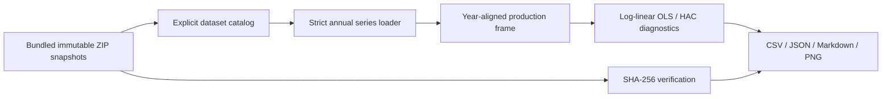

# Architecture

ClioFactors is a small offline-first research library rather than a collection of scripts that happen to run. Its supported surface is the `cliofactors` module and `cliofactors` CLI.

## Data lineage

## Boundaries

- `catalog.py`: source registries are explicit and stable. Each dataset defines exact ZIP member and columns; user-supplied ZIP members are never arbitrarily extracted.
- `data.py`: Unicode-safe CSV loading with strict duplicate-year validation; series are linked by annual index using an inner join. No interpolations, no implicit frequency aggregation.
- `model.py`: pure numerical function operating on a validated DataFrame; returns a dataclass with diagnostics and an observation table. No plots, disk I/O or network dependencies.
- `reporting.py`: orchestration, provenance fingerprint, deterministic outputs. Some numeric fields are environment-version dependent; a manifest captures installed versions.
- `charts.py`: headless, explicit image creation, with figures always closed.
- `cli.py`: explicit command parsing, stable exit codes and friendly failures.
- `datasets/`: CSV-in-ZIP original data and checked SHA-256 hashes; installed as package resources.
- `legacy/`: frozen original scripts. They are not part of tests or the public Python API.

## Non-goals for v1

External live APIs, automated web scraping, notebooks as the only reproducible form, a plugin framework, custom storage services, causal inference, and predictive claims. Each would add a new validation and maintenance surface.

## Extensions

Add a catalog entry and tests for a known historical series; define a research recipe in `reporting.py` once its units and provenance are documented. Use semantically meaningful names (`output`, `labor`, `capital`) within the model and preserve source identifiers (`DT19AS01`, etc.) at the I/O boundary.
